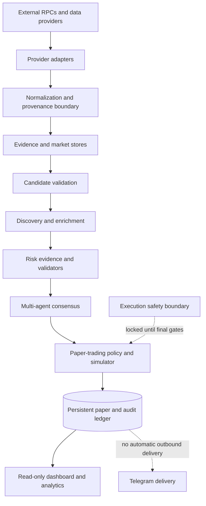

# VELTRIX Multi-Agent Crypto — System Architecture

**Document status:** Stage 1 architecture baseline  
**Architecture version:** 1.0  
**Repository baseline:** `main` at `0a46976b08812dd5f2121fa2e112caed0ef9a855`  
**Scope:** Solana-first meme-coin intelligence platform; existing Base/BSC adapters and records are preserved.

## 1. Product boundary

VELTRIX is a staged token-intelligence and simulated-trading system. Its purpose is to discover candidate assets, gather independently attributable evidence, assess risk, form an explainable multi-agent decision, and evaluate decisions in paper trading before any future execution release.

The system is not an exchange, custodian, wallet, signer, or guarantee of token safety. Market observations and third-party claims are untrusted until normalized, freshness-checked, provenance-checked, and validated against a claim-specific policy.

The nine stages are sequential acceptance gates:

1. Architecture and foundation.
2. Candidate validation.
3. Solana discovery.
4. Token intelligence.
5. Security and risk.
6. AI consensus.
7. Paper trading.
8. Dashboard and analytics.
9. Live-execution safety.

A later stage cannot be accepted merely because code exists on an unmerged branch. Each stage requires a reviewed change set, passing automated tests, documented evidence, and explicit exit criteria. Stage 9 implementation is not authorization to activate live execution.

## 2. High-level service topology



The diagram describes logical ownership, not a claim that all arrows are currently wired end-to-end. Existing code includes adapters, evidence stores, safety validators, consensus, paper runtime, dashboard, and execution-policy primitives. Their real-provider coverage and end-to-end acceptance remain separately tracked.

### 2.1 Component responsibilities

| Boundary | Responsibility | Must not do |
|---|---|---|
| Provider adapters | Read external RPC/API data; preserve provider identity and source references | Decide trust or authorize a trade |
| Normalization | Canonicalize chain, address, units, timestamps, source and coverage | Invent missing values or silently merge conflicting evidence |
| Candidate registry | Maintain stable chain/address identity and candidate lifecycle | Treat promotional discovery as proof of organic demand |
| Intelligence | Produce typed market, wallet, launch and holder observations | Promote an untrusted provider into a trusted source |
| Risk/evidence validation | Validate claim-specific provenance, completeness, freshness and ownership | Treat unknown evidence as a pass |
| Consensus | Combine independent, attributable agent outputs and explain abstentions | Sign or submit a transaction |
| Paper trading | Simulate fills, fees, slippage, exposure and exits in an isolated ledger | Access wallet signing material or live submission |
| Dashboard | Read persisted state and expose operational diagnostics | Mutate trading state or bypass policy |
| Execution boundary | Later validate intent, policy, simulation, authorization and idempotency | Be enabled by a generic environment boolean |

## 3. Trust boundaries and data flow

1. **External source boundary:** every RPC/API response is untrusted input. Transport success is not evidence correctness.
2. **Provider identity boundary:** the adapter records the provider identity, ownership group, endpoint class, retrieval time and source reference. Provider IDs alone do not establish independence.
3. **Normalization boundary:** values are validated before entering shared stores. Token identity is the tuple `(chain, canonical_address)`; Solana base58 addresses remain case-sensitive, while EVM addresses are normalized consistently.
4. **Evidence boundary:** every safety claim is typed and claim-scoped. Missing, stale, future-dated, incomplete, conflicting, or wrong-subject evidence is unknown/rejected, never positive.
5. **Decision boundary:** consensus consumes validated evidence and records its reasons, input references and policy version. A consensus approval is not an execution authorization.
6. **Paper boundary:** simulated orders use a separate paper ledger and never gain a signer or RPC submission capability.
7. **Release boundary:** production deployment, Telegram delivery, scheduling and live trading are locked. The runtime rejects attempts to turn these on.

## 4. Canonical identity and evidence contracts

### 4.1 Asset identity

Every asset reference must carry:
- `chain_id` or canonical chain key (`solana`, `base`, `bsc`);
- canonical mint/contract address;
- native token decimals where known, with source and retrieval context;
- first-seen time and the source that established discovery;
- lifecycle state and stable internal candidate ID.

Never identify an asset by symbol or name alone. Symbols are mutable, duplicated and untrusted metadata.

### 4.2 Observation envelope

All provider observations entering a shared intelligence path should be representable by this logical envelope:

```json
{
  "schema_version": "1",
  "observation_id": "stable-unique-id",
  "subject": {"chain": "solana", "address": "canonical-mint"},
  "claim": "market_price",
  "provider": {"id": "provider-id", "ownership_group": "operator-verified-group"},
  "observed_at_ms": 0,
  "retrieved_at_ms": 0,
  "source_ref": "provider request, transaction, slot, block or response reference",
  "coverage": {"complete": false, "from": null, "to": null, "watermark": null},
  "payload_hash": "sha256-of-canonical-payload",
  "payload": {}
}
```

This is a contract, not a new database migration. Existing typed reports and stores remain authoritative until a later stage proposes and tests a compatible migration. Do not rewrite historical records to fit this document.

### 4.3 Evidence semantics

- Event time and retrieval time are distinct.
- Chain evidence includes slot/block and commitment/finality context where applicable.
- Amounts are stored as raw integer units; decimal display values are derived.
- Completeness is explicit and scoped to a declared query/window.
- A missing field is unknown, not zero.
- A source reference must be reproducible enough for independent review.
- Corrections append a new observation with provenance; they do not silently rewrite prior decisions.

### 4.4 Decision and audit records

A decision record should bind:
- candidate identity;
- decision ID and creation time;
- agent identities and individual dispositions;
- evidence observation IDs/hashes;
- policy/configuration version;
- accepted/rejected/abstained disposition and reason codes;
- whether it is eligible for paper review;
- an explicit `execution_authorized=false` field before any separately approved release.

The existing append-oriented SQLite event/evidence stores are retained. No schema migration is authorized by Stage 1.

## 5. Persistence and infrastructure

- Preserve the existing GitHub repository, GitHub Actions CI, Vercel project, Neon/other configured data services, and existing credential stores.
- The repository currently uses SQLite stores for the paper ledger and several Solana intelligence domains. Existing database paths and records must not be renamed, reset, or migrated without a separately tested backup/restore plan.
- The shared `DB_PATH` / `VELTRIX_SOLANA_DISCOVERY_DB` contract must remain consistent where the existing runtime requires it.
- Do not place API keys, private RPC URLs, signing material, wallet secrets or Telegram bot tokens in source control, logs, generated artifacts, or architecture documents.
- Keep public wallet addresses separate from credentials. The application must never accept seed phrases or raw private keys.
- CI may run deterministic tests and explicitly scoped read-only acceptance probes. It must not run scheduled production work or submit transactions.
- Vercel preview deployments are allowed only when specifically required for review. Production deployment remains locked.

## 6. Runtime and release controls

The runtime now has a single fail-closed release-control validator. Defaults are development, Telegram off, scheduler off and live trading off. Invalid boolean values or unsupported deployment targets are errors. A production target or any attempt to enable Telegram, scheduling or live trading is rejected before application work begins.

The controls are intentionally independent of paper-trading configuration. Paper trading is a later stage and must remain disabled by default until its own acceptance gate passes.

No Telegram integration or scheduler is introduced by Stage 1. No production deployment workflow is introduced.

## 7. Security principles

- Least privilege for provider/API credentials and CI tokens.
- Read-only RPC/API access for discovery and intelligence.
- No private-key or seed-phrase ingestion.
- Explicit allowlists are claim-specific and ownership-aware.
- Freshness, chain, subject, completeness and source identity are checked at the consuming boundary.
- Fail closed on unknown, partial, stale, malformed or conflicting evidence.
- Durable audit records are redacted and do not contain credentials.
- Idempotency and replay protection are mandatory before any future external side effect.
- Simulation and paper state are isolated from wallet and live state.
- No hidden fallback to a weaker provider, stale cache, or weaker risk policy.

## 8. Stage acceptance model

Each stage must deliver:
1. architecture and interface contract;
2. implementation isolated behind the prior stage's accepted interfaces;
3. unit, integration, negative and adversarial tests;
4. provenance and coverage evidence for external sources;
5. reproducible CI results on the exact commit;
6. operational and rollback notes;
7. explicit proof that later-stage capabilities remain disabled.

A stage is **not complete** because its PR exists, its tests compile, a preview builds, or a provider returns HTTP 200. Completion requires its own acceptance criteria and independent evidence.

## 9. Stage 1 exit criteria

- [x] Existing repository and infrastructure inventoried without destructive changes.
- [x] Nine-stage dependency order documented.
- [x] Service responsibilities and trust boundaries documented.
- [x] Canonical asset, observation, evidence and decision contracts documented.
- [x] Persistence, credential and secret-handling constraints documented.
- [x] Runtime release switches fail closed for production, Telegram, scheduler and live trading.
- [ ] Full CI and targeted adversarial tests pass on the Stage 1 PR head.
- [ ] Architecture review confirms no unintended changes to existing data, credentials, workflows or deployments.

Stage 1 remains open until the final two criteria are independently verified.
